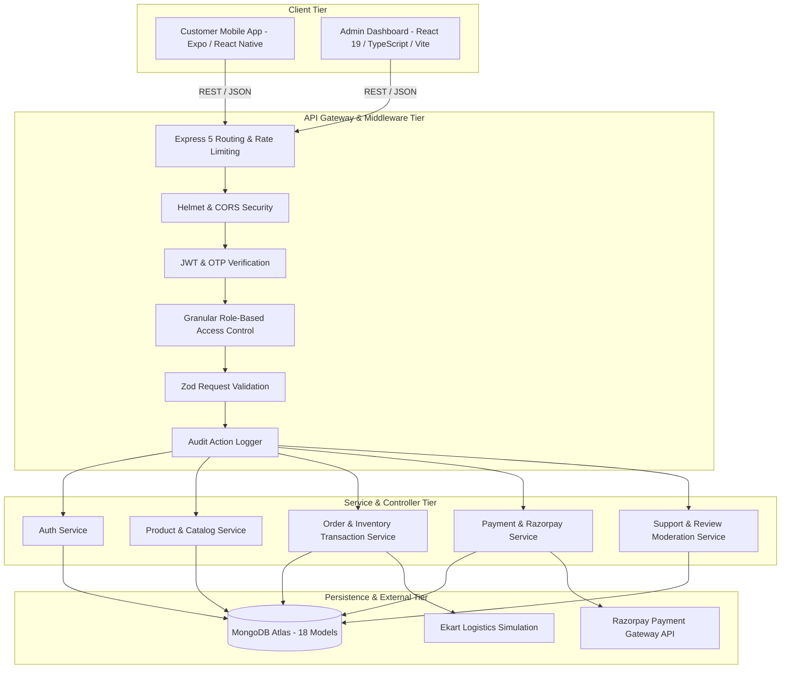
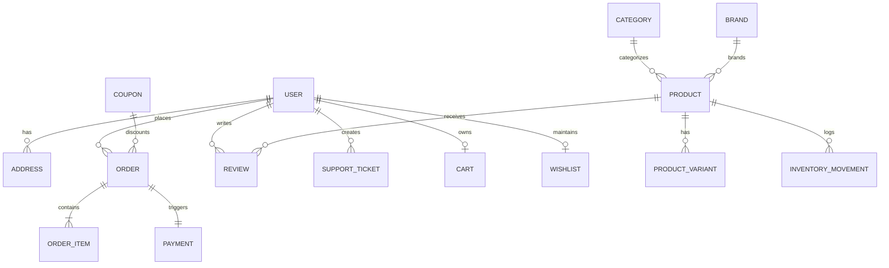

# Flipkart Clone — System Architecture & Design Specification

## 1. System Overview & High-Level Architecture

The platform is designed as a distributed, high-performance e-commerce ecosystem consisting of three core applications and a managed database tier:

1. **Customer Mobile Application (`mobile/`)**: Developed using React Native Expo with TypeScript, providing native Android, iOS, and responsive Web experiences inspired by Flipkart's usability (category grids, deals carousel, smart search, variant selectors, coupon engine, address manager, and Ekart milestone tracking).
2. **Administrative Operations Dashboard (`admin/`)**: Developed using React 19, TypeScript, Vite, Tailwind CSS, Lucide icons, and Recharts, providing 16 management modules with real-time statistics, inventory management, review moderation, order transitions, customer 360°, and audit logging.
3. **Enterprise REST API Backend (`backend/`)**: Developed using Node.js, Express.js, and Mongoose, implementing stateless JWT authentication with refresh tokens, OTP rate limiting, granular role-based access control (RBAC), database transaction-backed order processing, server-side verified pricing and inventory reservations, and automated audit trails.
4. **Data Tier**: MongoDB Atlas multi-node cluster enforcing unique indexes, compound search indexes, and document validation schemas across 18 models.

---

## 2. Granular Role-Based Access Control (RBAC)

The system implements strict server-enforced role authorization. Frontend visibility restrictions are supplemented by mandatory middleware authorization checks on all REST endpoints.

| Feature / Module | Super Admin | Admin | Product Manager | Order Manager | Support Agent | Customer |
| :--- | :---: | :---: | :---: | :---: | :---: | :---: |
| **System Settings & Config** | ✅ Full | ❌ | ❌ | ❌ | ❌ | ❌ |
| **Staff & Role Management** | ✅ Full | ❌ | ❌ | ❌ | ❌ | ❌ |
| **Audit Logs Viewer** | ✅ Read | ✅ Read | ❌ | ❌ | ❌ | ❌ |
| **Products & Categories** | ✅ Full | ✅ Full | ✅ Full | ❌ Read Only | ❌ Read Only | ❌ Read (Active) |
| **Inventory & Stock Adjustments** | ✅ Full | ✅ Full | ✅ Full | ❌ Read Only | ❌ | ❌ |
| **Orders & Fulfillment** | ✅ Full | ✅ Full | ❌ Read Only | ✅ Full | ❌ Read Only | ❌ Own Orders |
| **Shipment & Delivery Management** | ✅ Full | ✅ Full | ❌ | ✅ Full | ❌ Read Only | ❌ Own Tracking |
| **Coupons & Promotional Rules** | ✅ Full | ✅ Full | ❌ Read Only | ❌ | ❌ | ❌ Redeem Only |
| **Payments & COD Reconciliation** | ✅ Full | ✅ Full | ❌ | ❌ Read Only | ❌ | ❌ Own Invoices |
| **Customer Support & Complaints** | ✅ Full | ✅ Full | ❌ | ❌ | ✅ Full | ❌ Own Tickets |
| **Reviews Moderation** | ✅ Full | ✅ Full | ✅ Moderate | ❌ | ✅ Moderate | ❌ Post Own Review |
| **Homepage Banners & CMS** | ✅ Full | ✅ Full | ✅ Full | ❌ | ❌ | ❌ View Only |
| **Customer Profiles & CRM** | ✅ Full | ✅ Full | ❌ | ❌ Read Only | ✅ Permitted Only | ❌ Own Profile |

---

## 3. Core Database Schemas (18 Collections)

### Collection Definitions

1. **`roles`**: Defines permissions and role hierarchy (`SUPER_ADMIN`, `ADMIN`, `PRODUCT_MANAGER`, `ORDER_MANAGER`, `SUPPORT_AGENT`, `CUSTOMER`).
2. **`users`**: Customer and administrative staff profiles with bcrypt-hashed passwords, mobile phone, OTP counters, and verification flags.
3. **`categories`**: Hierarchical category tree (Electronics, Mobiles, Fashion, Appliances, Home, Beauty) with parent-child references.
4. **`brands`**: Verified manufacturers with logo assets and verification badges.
5. **`products`**: Flagship e-commerce catalog items with title, slug, SKU, specs array, highlights, gallery images, rating aggregations, and stock status.
6. **`product_variants`**: SKU-level color/storage/size options with individual pricing, MRP, and inventory tracking.
7. **`carts`**: Active customer shopping carts with items, selected variants, and server-side applied coupon metadata.
8. **`wishlists`**: Persisted customer favorites list with quick-add references.
9. **`addresses`**: Structured delivery locations with pincode, landmark, street address, and address type (HOME/WORK).
10. **`orders`**: Immutable order records with human-readable Order IDs (`OD...`), subtotal, discount, delivery fee, taxes, total, payment status, and order status lifecycle.
11. **`order_items`**: Line items within an order snapshotting product title, unit price, MRP, SKU, and selected variant.
12. **`payments`**: Transaction records with payment provider (`RAZORPAY`, `COD`), transaction IDs, signature hashes, and settlement states.
13. **`coupons`**: Promotional discount rules (`PERCENTAGE`, `FLAT`) with min order value, max discount cap, expiry timestamps, and usage limits.
14. **`inventory_movements`**: Immutable stock audit ledger capturing type (`RESTOCK`, `ORDER_RESERVED`, `ORDER_CANCELLED`, `DAMAGE_ADJUSTMENT`), quantity change, and admin user reference.
15. **`reviews`**: Verified purchaser product ratings (1-5 stars), headline, comment, images, and moderation status (`PENDING`, `APPROVED`, `REJECTED`).
16. **`support_tickets`**: Customer inquiries and complaints with category, priority, status (`OPEN`, `IN_PROGRESS`, `RESOLVED`, `CLOSED`), and conversation message history.
17. **`banners`**: Homepage promotional carousel slides with action URLs and display ordering.
18. **`audit_logs`**: Immutable security audit trail recording IP address, admin user ID, action verb, target model, and timestamp.

---

## 4. Critical Workflows & Business Logic

### A. Server-Side Verified Pricing & Checkout
Clients never compute or submit order totals. The backend enforces complete calculation integrity:
1. Client submits cart items with product ID, variant ID, and quantity.
2. Server loads current product records directly from MongoDB and verifies publication status and real-time stock availability.
3. Server recalculates MRP, catalog selling price, and applicable category discounts.
4. If a coupon code is supplied, the server validates its active date window, minimum order threshold, and remaining redemption quota.
5. Delivery fees are calculated dynamically based on store settings (e.g., Free delivery above ₹500, else ₹40).
6. Order is created within a database session, reserving inventory atomically and transitioning the cart.

### B. Two-Phase Payment Verification (Razorpay / COD)
1. **Razorpay Online Flow**:
   - Backend creates a Razorpay Order entity and returns `razorpayOrderId`.
   - Client opens Razorpay Checkout SDK.
   - Upon completion, client posts `razorpay_order_id`, `razorpay_payment_id`, and `razorpay_signature`.
   - Backend computes HMAC SHA256 signature using `RAZORPAY_KEY_SECRET`.
   - On valid signature match: Payment status transitions to `COMPLETED`, order status updates to `CONFIRMED`, and a notification is dispatched.
2. **Cash on Delivery (COD) Flow**:
   - Backend verifies COD eligibility for target pincode and order value.
   - Order transitions immediately to `CONFIRMED` with payment status `PENDING`.
   - Payment is reconciled upon delivery confirmation by the logistics partner.

### C. Ekart Delivery Milestone Lifecycle
Orders progress through defined logistics milestones:
`PENDING` ➔ `CONFIRMED` ➔ `PACKED` ➔ `SHIPPED` ➔ `OUT_FOR_DELIVERY` ➔ `DELIVERED`

- **Cancellation Window**: Customers may cancel an order before `SHIPPED` status. Prepaid payments trigger immediate refund creation, and reserved inventory is returned to stock automatically via an `ORDER_CANCELLED` inventory movement.
- **Return & Refund Window**: Customers may initiate return requests within 7 days of delivery. Upon admin inspection approval, refund workflows credit the transaction.
